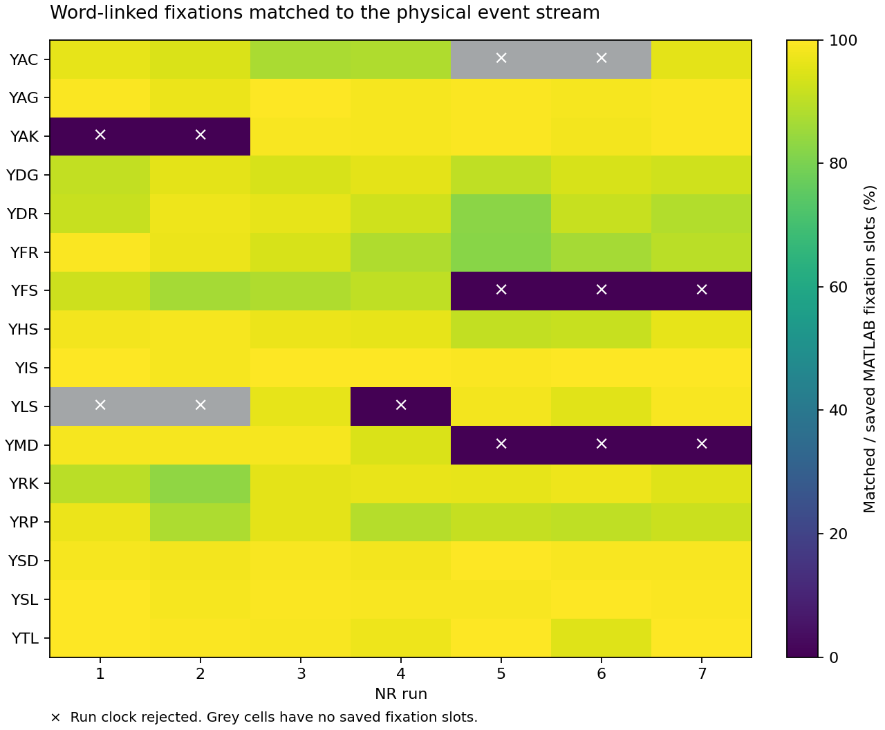

# Matching MATLAB word fixations to NEMAR event rows

MATLAB assigns saved fixation segments to words. NEMAR provides the run clock and the full sequence of physical events. Matching establishes a pair of identifiers, for example `YAC/NR/s1/w1/f1` and `YAC/NR/run1/events_row17`. The latter counts the TSV header as row 1. EEG sample indices and binary byte offsets start at zero. [Example pairs](example_pairs.csv)

| Scope | Bounded pilot | Extended NR audit |
| --- | ---: | ---: |
| Participants | 3 | 16 |
| Participant × task × run blocks | 7 | 112 |
| Participant × sentence slots examined | 92 | 5,584 |
| Saved MATLAB fixation slots | 2,829 | 106,673 |
| Matched | 2,753 | 95,393 |
| Ambiguous / unmatched / invalid | 0 / 0 / 76 | 728 / 395 / 10,157 |

The pilot uses NR runs 1 and 4 in YAG, YDG and YIS, plus YAG TSR run 1. It includes calibration and held-out sentences. The extended audit examines all 349 NR sentence slots per training participant and 105,341 participant-specific word positions. It reuses 2,166 previously confirmed NR pairs after checking the MATLAB segment hash, fixation identity and onset against the NEMAR row. Those pairs are already included in the extended total. [Pilot block counts](pilot_blocks.csv) · [Full summary](full_summary.json) · [Decisions and reasons](decision_reasons.csv)

## Matching rule

For each run, ordered multi-word sequences establish a constant offset between the MATLAB eye-tracker clock and the NEMAR event clock. A qualifying calibration sentence needs at least six anchors over three words and one second, and the strongest competing group must have less than half as many anchors. Three qualifying sentences must span at least 60 seconds with anchor residuals within 4 ms. The extension searches predefined beginning, middle and end neighbourhoods within the seven NR ranges. [Settings](matching.json)

The onset tolerance is 4 ms after clock conversion. The duration tolerance is 4 ms after comparing the MATLAB segment span with the NEMAR duration plus 2 ms. The gaze tolerance is a Euclidean distance of 2 pixels from the mean MATLAB gaze excluding the last endpoint. A new pair also needs the expected word text and presentation interval, one-to-one temporal order, and support from at least four matches across three words and one second. Multiple candidates, collisions, inconsistent metadata and insufficient sequence support remain visible in the decision table. A slot with unusable rawET is invalid.

Run clocks passed in 99 of 112 blocks. The largest absolute onset error among confirmed NR pairs was 2 ms. All 198 wrong-run or wrong-participant control sequences failed to meet the acceptance criteria. The separate physical-event check revisited the current fixation duration, previous and next fixation, and available incoming saccade in the event stream for all 95,393 matches, with zero recorded errors. The incoming saccade must end within 4 ms before fixation onset. [Block results](full_blocks.csv) · [Physical-event checks by run](physical_event_checks.csv)

## Locating the EEG sample

The stored pointer uses `floor(onset_s × Hz + 0.5)`. The sample index multiplied by the frame size gives the byte offset. All 95,393 nearest-sample indices lie inside their run binaries. Of these pairs, 91,010 also passed the separate EEG-chain check. In four YTL runs (3–6), marker times agreed but the marker-to-trigger codes lacked a one-to-one correspondence. Their 4,383 pairs retain the word and physical fixation link, with `EEG_chain_eligible=False`. This flag describes headers, marker clocks and file bounds. It does not assess signal quality. [Example pointers and eligibility](example_pairs.csv)

## Reproduction

```sh
python audit/alignment/audit_zuco2_alignment.py
python audit/alignment/integration.py
(cd audit/alignment && shasum -a 256 -c reference_tables.sha256)
```

The second command reads matches.csv and evidence.json produced by the first. Both commands require the MATLAB train and NEMAR files. The pilot and extension write separate output directories. Supply `--out` to change either destination and `--pilot` to point the extension to a different pilot directory. The checksum list covers the four pilot CSVs and eight full-stage tables/JSON files with the tested dependency versions. All compared files matched byte for byte.

The figure shows the fraction of saved fixation slots matched per participant and run. It was drawn for this release from full_blocks.csv. Run `python audit/alignment/plot_coverage.py` to redraw it.


