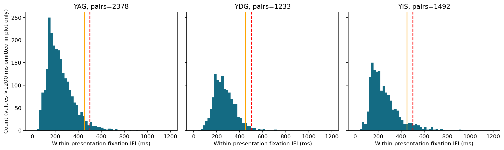

# NEMAR run recordings

The release contains one BrainVision triplet per run, a table of physical events and a compressed stream of eye-tracking samples. The audit parses the headers, counts frames from the binary sizes, checks marker positions and reads the events and word-measure tables. One YAG/NR/run-1 signal slice tests the header calibration and time indexing.

| Inventory | Early download | Completed v1.0.0 |
| --- | ---: | ---: |
| BrainVision triplets matching manifest sizes | 235 | 252 |
| Available events.tsv files | 248 | 252 |
| Fixation / saccade / blink rows | 275,608 / 275,509 / 21,644 | 280,727 / 280,629 / 22,063 |
| Continuous eye-tracking files | 1 | 252 |

The early copy lacked 315 files and contained two truncated EEG binaries. The early prose report listed 246 event tables. Counting run records with an event summary in the archived evidence gives **248**, reproduced on the reconstructed early snapshot. The completed inventory covers 18 participants, two tasks and seven runs per task. The 36 word-measure tables contain 263,102 rows but have no unique event-onset key. [Snapshot counts](coverage.csv) · [Completed per-run inventory](run_inventory.csv)

All headers specify E1–E128 and 500 Hz. The multiplexed binaries contain 32-bit floating-point samples. All 252 marker files have positions inside their EEG arrays, while four event tables contain onsets later than the last EEG sample plus 100 ms. The task-level metadata names Cz as the reference. The YAG run sidecar gives the reference as n/a. Cz is absent from the stored channel list. File-level rereferencing, filter history and absolute physiological timing accuracy remain unresolved. [Header and YAG probe](header_and_probe.json)

```sh
python audit/nemar/audit_nemar_nm000279.py
python audit/nemar/plot_intervals.py
```

The figure comes from a later event-timing check in YAG, YDG and YIS (NR, run 1). It counts adjacent physical fixations within trigger-delimited presentations, including fixations without a word assignment. An interval may place the next fixation within the response window of the current word. The bars and their numeric summaries were reproduced from the event tables. [Interval summaries](fixation_intervals.json)


